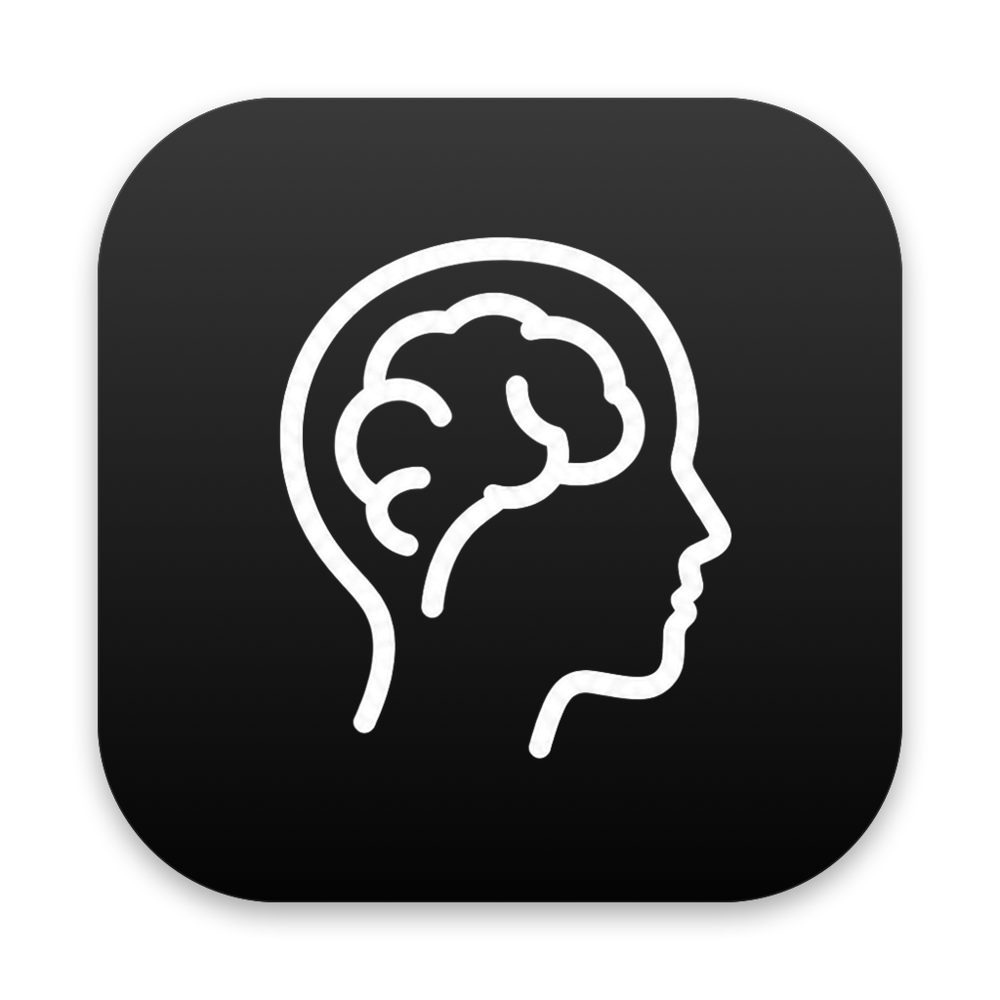
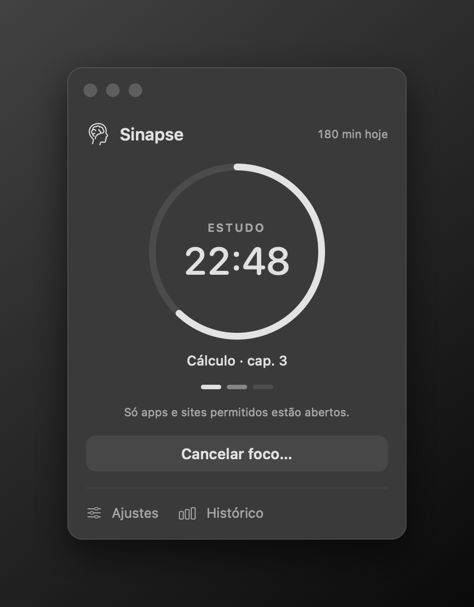
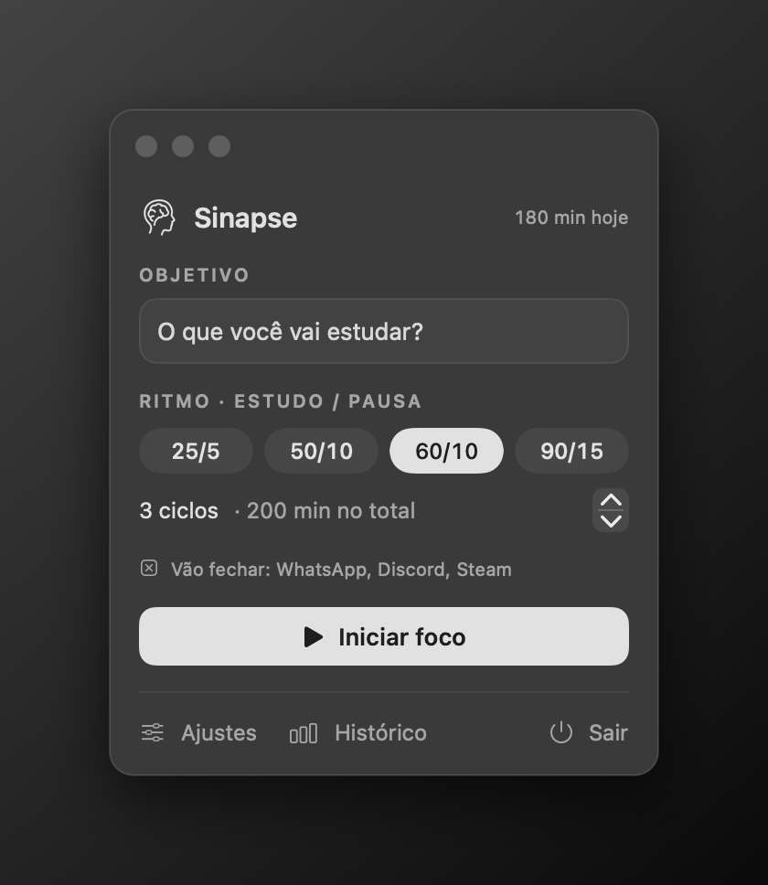
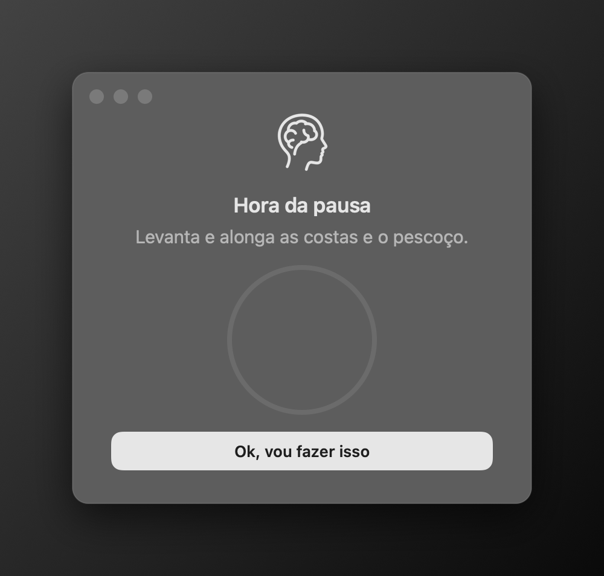
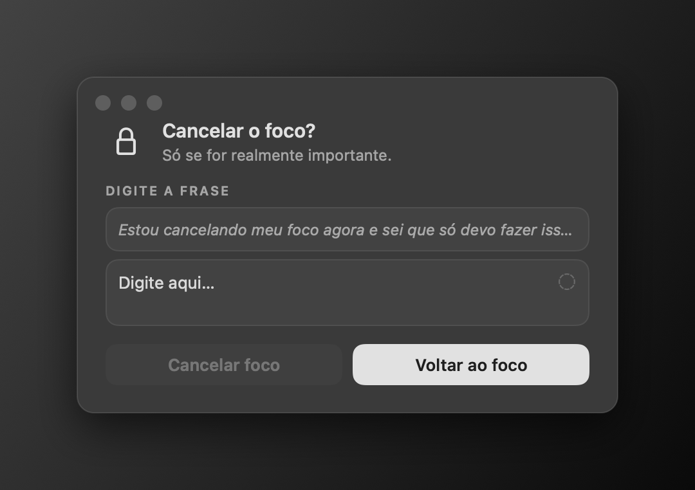
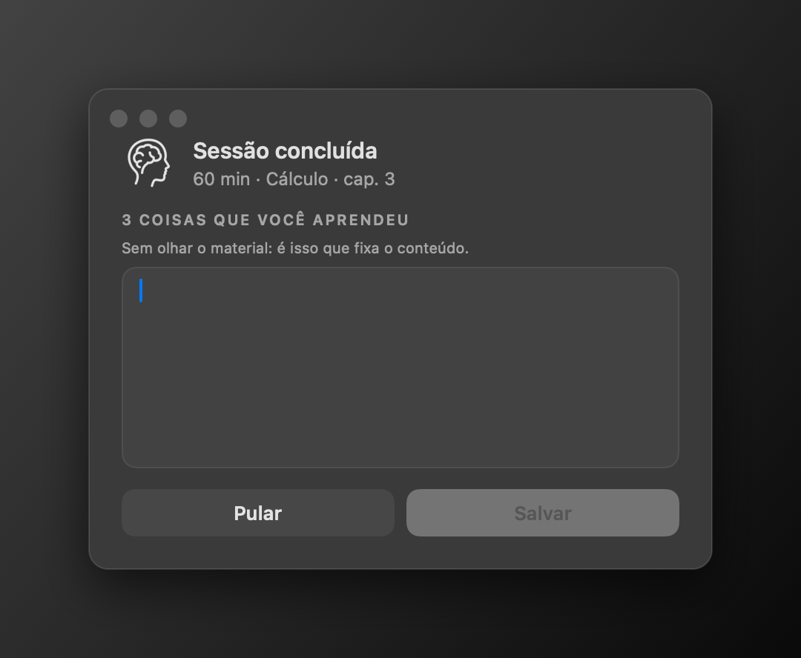
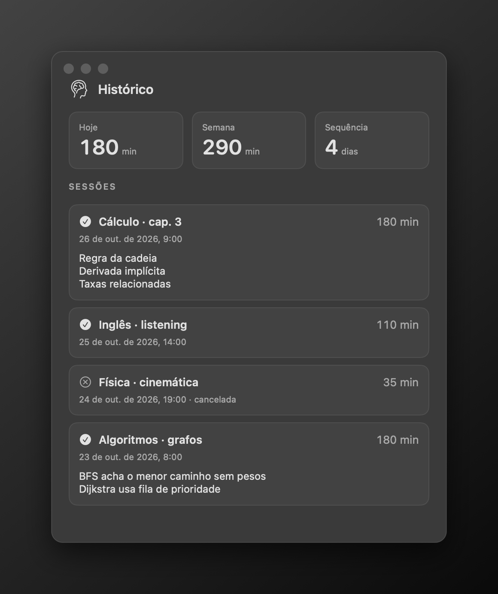
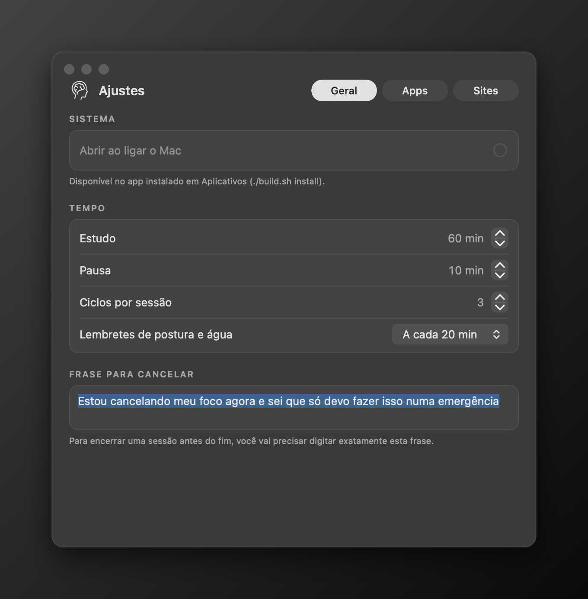

<div align="center">



# Sinapse

**Foco de verdade para estudar no Mac.**
Só os apps e sites que você escolher, pausas na hora certa e nada de cancelar por impulso.


[Instalar](#-instalação) · [Como usar](#-como-usar) · [Recursos](#-recursos) · [Permissões](#-permissões) · [Perguntas frequentes](#-perguntas-frequentes) · [Compilar](#-compilar-a-partir-do-código)

<br>



</div>

---

## ✨ Recursos

- **Lista de permitidos.** Durante o estudo, só funcionam os apps que você marcou (por exemplo Claude, ChatGPT, Obsidian e o navegador). Qualquer outro app é fechado na hora, mesmo se você tentar abrir de novo.
- **Sites permitidos.** No Chrome, Safari, Brave, Edge, Arc e Vivaldi, abas de sites fora da lista viram uma página em branco. Já vem com claude.ai, chatgpt.com, Gemini, Perplexity, NotebookLM e Google Docs/Drive.
- **Ciclos de estudo e pausa.** Ritmos prontos (25/5, 50/10, 60/10, 90/15) ou o seu. Na pausa aparece uma janela com uma sugestão ("Levanta e alonga as costas…") e os apps ficam liberados.
- **Lembretes durante o estudo.** A cada 20 minutos (configurável): postura, água e descanso dos olhos.
- **Cancelar dá trabalho de propósito.** Para encerrar antes do fim, você precisa digitar uma frase inteira. Dá pra sair numa emergência, mas não por impulso.
- **Revisão no fim.** Ao concluir, o Sinapse pede 3 coisas que você aprendeu, sem olhar o material. É o que mais ajuda a fixar o conteúdo.
- **Histórico.** Minutos de hoje e da semana, sequência de dias seguidos e o que você aprendeu em cada sessão.
- **Discreto.** Fica só na barra de menu, abre junto com o Mac (dá pra desligar) e não manda nenhum dado para fora: tudo fica no seu computador.

## 🖼️ Telas

| Começar | Em sessão |
| :---: | :---: |
|  |  |
| **Pausa** | **Cancelar** |
|  |  |
| **Fim da sessão** | **Histórico** |
|  |  |

<div align="center">

</div>

## 📦 Instalação

> Requer **macOS 13 (Ventura) ou mais novo**. Funciona em Macs com Apple Silicon e Intel.

### Opção 1: um comando (recomendado)

Abra o **Terminal** (⌘ + Espaço, digite "Terminal") e cole:

```bash
curl -fsSL https://raw.githubusercontent.com/Magnumja/sinapse/main/install.sh | bash
```

Ele baixa a última versão, instala em **Aplicativos** e abre o app. Para atualizar depois, é só rodar o mesmo comando.

### Opção 2: download manual

1. Baixe o **`Sinapse.zip`** na página de [Releases](https://github.com/Magnumja/sinapse/releases/latest).
2. Dê dois cliques para descompactar e arraste o **Sinapse** para a pasta **Aplicativos**.
3. Na primeira vez, o macOS avisa que o app é de um "desenvolvedor não identificado" (ele não é notarizado pela Apple). Para liberar:
   - abra **Ajustes do Sistema › Privacidade e Segurança**, role até o fim e clique em **Abrir Mesmo Assim**; ou
   - no Terminal, rode `xattr -dr com.apple.quarantine /Applications/Sinapse.app`.

### Opção 3: compilar você mesmo

Veja [Compilar a partir do código](#-compilar-a-partir-do-código).

## 🚀 Como usar

1. Clique no **ícone do cérebro** na barra de menu, perto do relógio.
2. Escreva **o que você vai estudar** e escolha o **ritmo** (estudo/pausa) e quantos **ciclos**.
3. Confira a linha **"Vão fechar"**: são os apps abertos que não estão na sua lista.
4. Clique em **Iniciar foco** (ou aperte Enter).

Durante a sessão, a barra de menu mostra o tempo restante. Os **Ajustes** ficam travados até o fim, para você não mudar as regras no meio.

Para configurar, abra **Ajustes**:

| Aba | O que dá pra mudar |
| --- | --- |
| **Geral** | Abrir ao ligar o Mac, tempos de estudo e pausa, ciclos, lembretes e a frase de cancelamento |
| **Apps** | Quais apps funcionam durante o estudo (busca e filtro "Permitidos") |
| **Sites** | Quais sites abrem nos navegadores permitidos (subdomínios entram junto) |

## 🔐 Permissões

O macOS pede algumas permissões na primeira vez. Todas ficam no seu Mac.

| Permissão | Para quê | Onde mudar |
| --- | --- | --- |
| **Notificações** | Avisos de pausa, lembretes e apps fechados | Ajustes do Sistema › Notificações › Sinapse |
| **Automação** (Chrome, Safari…) | Ler as abas abertas e bloquear sites fora da lista | Ajustes do Sistema › Privacidade e Segurança › Automação |
| **Itens de Início** | Abrir o Sinapse quando o Mac liga | Ajustes do Sinapse › Geral, ou Ajustes do Sistema › Geral › Itens de Início |

Se você negar a Automação para um navegador, o menu do Sinapse mostra um aviso e aquele navegador fica sem filtro de sites.

### Navegadores

| Filtra sites | Sem filtro de sites |
| --- | --- |
| Chrome, Safari, Brave, Edge, Arc, Vivaldi | Opera, Opera GX, Firefox (não permitem ler as abas) |

Navegadores sem filtro funcionam normalmente se você permitir o app, mas aí qualquer site abre. Para estudar com rigor, deixe-os fora da lista.

## ❓ Perguntas frequentes

<details>
<summary><b>Dá pra burlar?</b></summary>

Você é o dono do Mac, então sempre dá: por exemplo, forçando o encerramento do Sinapse pelo Monitor de Atividade, se ele estiver na sua lista de permitidos. A ideia não é ser uma prisão, e sim criar **atrito** suficiente para você perceber que está fugindo do estudo. Na prática, ter que digitar uma frase inteira já faz a maioria das pessoas desistir de cancelar.
</details>

<details>
<summary><b>Um app foi fechado e eu tinha coisas sem salvar?</b></summary>

O Sinapse pede para o app fechar do jeito normal, como o ⌘Q. Apps com documentos abertos mostram a pergunta "Salvar alterações?" antes de fechar. Mesmo assim, antes de começar, confira a linha **"Vão fechar"** no menu.
</details>

<details>
<summary><b>O que acontece se eu reiniciar o Mac no meio da sessão?</b></summary>

A sessão é salva. Quando o Sinapse abrir de novo, ela continua de onde parou. O tempo com o Mac desligado ou dormindo não conta como estudo.
</details>

<details>
<summary><b>Meus dados vão para algum lugar?</b></summary>

Não. Configurações e histórico ficam só no seu Mac (`~/Library/Preferences/io.github.magnumja.sinapse.plist`). O app não acessa a internet.
</details>

<details>
<summary><b>Como desinstalar?</b></summary>

1. Em **Ajustes › Geral**, desligue **Abrir ao ligar o Mac**.
2. Feche o Sinapse (menu › **Sair**) e arraste-o de **Aplicativos** para o Lixo.
3. Opcional, para apagar configurações e histórico: `defaults delete io.github.magnumja.sinapse`
</details>

## 🛠️ Compilar a partir do código

Você só precisa do **Xcode** ou das **Command Line Tools** (`xcode-select --install`). Não há dependências externas.

```bash
git clone https://github.com/Magnumja/sinapse.git
cd sinapse
./build.sh install
```

| Comando | O que faz |
| --- | --- |
| `./build.sh` | Gera `build/Sinapse.app` para a arquitetura do seu Mac |
| `./build.sh install` | Compila, copia para **Aplicativos** e abre |
| `./build.sh release` | Binário universal (Apple Silicon + Intel) e `build/Sinapse.zip` |
| `./Tools/screenshots.sh` | Regera os prints deste README (depois de `./build.sh`) |

Para ver uma tela sem iniciar uma sessão de verdade (nada é bloqueado nem salvo):

```bash
open build/Sinapse.app --args --preview sessao   # menu, sessao, ajustes, historico, pausa, cancelar, fim
```

### Estrutura

```
Sources/
  SinapseApp.swift    ponto de entrada, ícone da barra de menu, abrir ao ligar o Mac
  FocusEngine.swift   sessão, timer, bloqueio de apps e notificações
  Blockers.swift      lista de apps instalados e filtro de sites (AppleScript)
  Store.swift         configurações e histórico (UserDefaults)
  Views.swift         telas em SwiftUI
  Theme.swift         visual preto e branco, botões e cartões translúcidos
Assets/               ícone do app, ícone da barra de menu e logo
Tools/                geração de ícones e prints
```

## 📄 Licença

[MIT](LICENSE) © Magnum de Abreu
